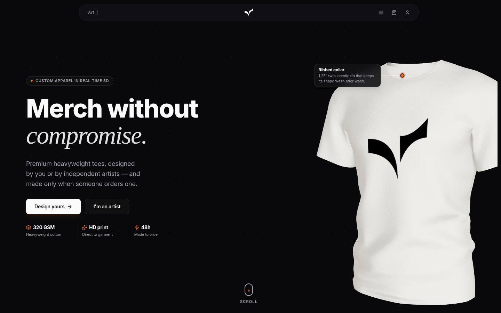
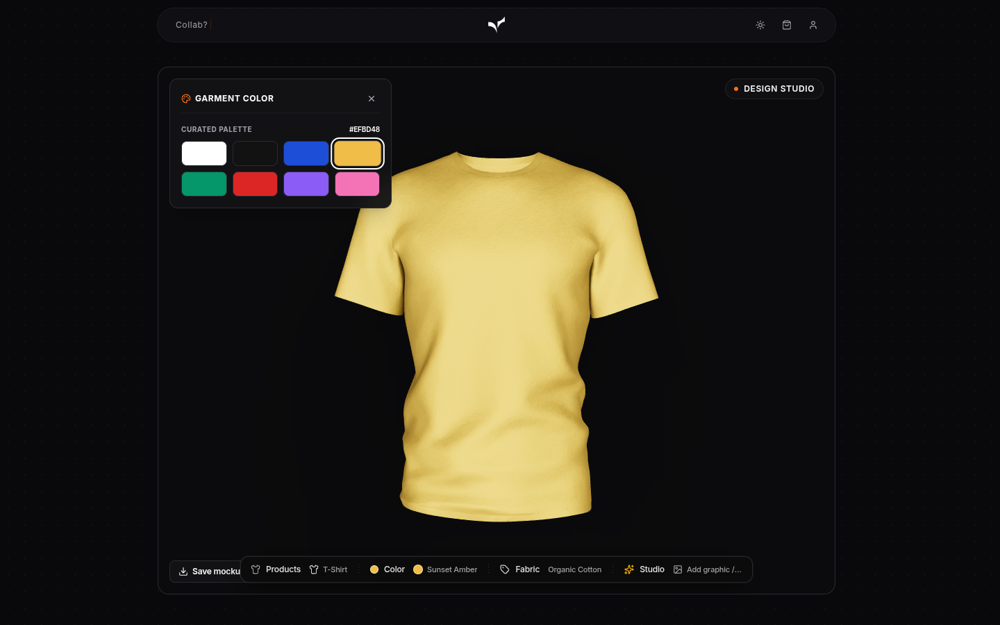
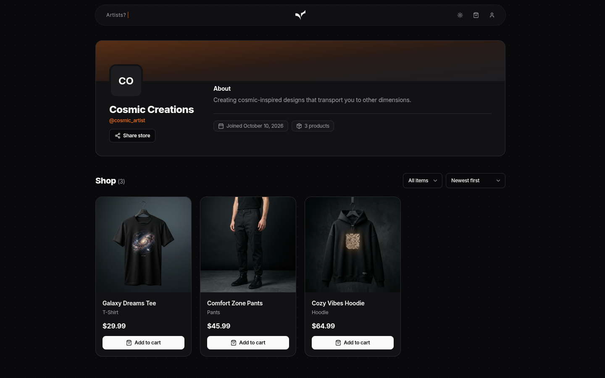
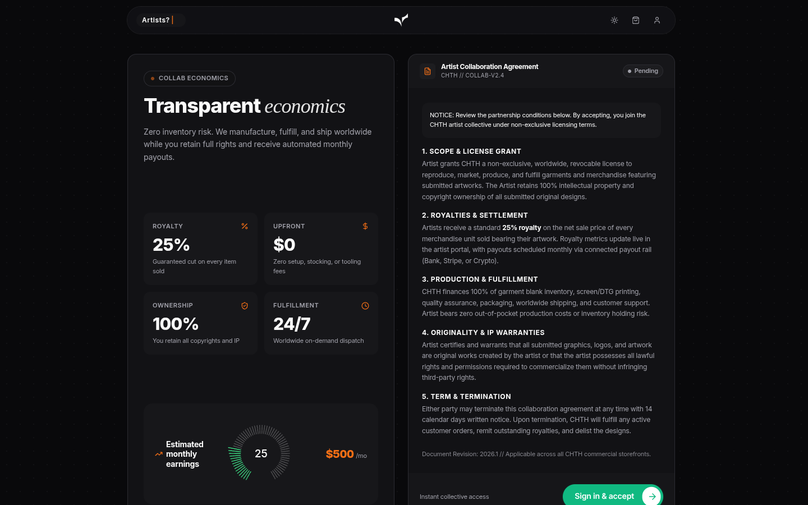
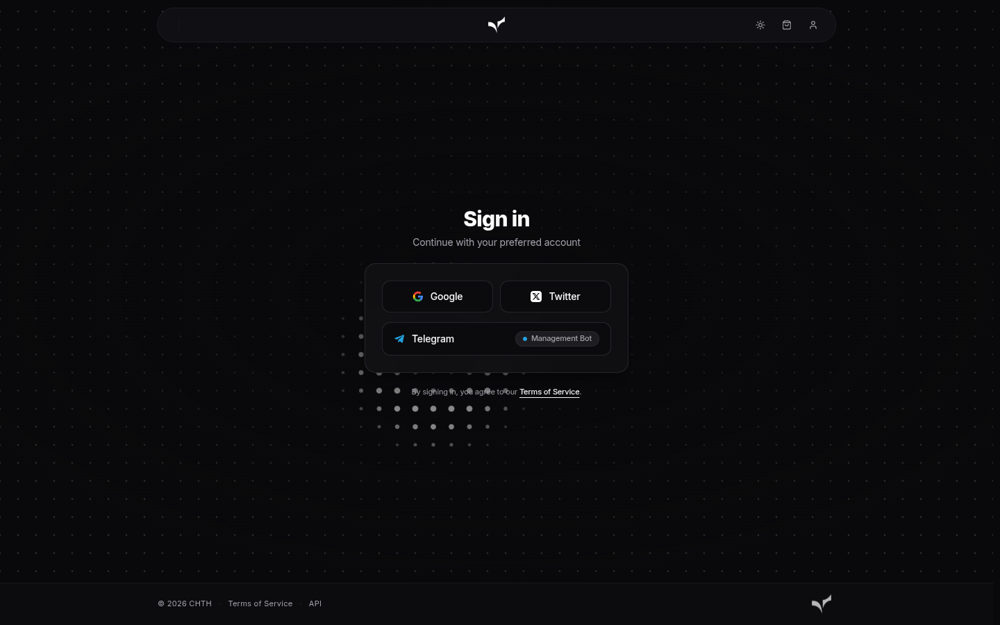
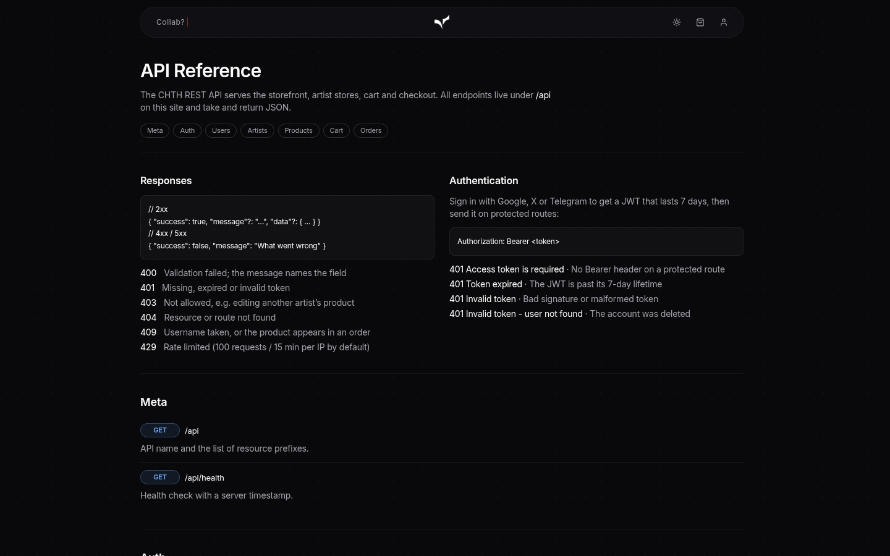
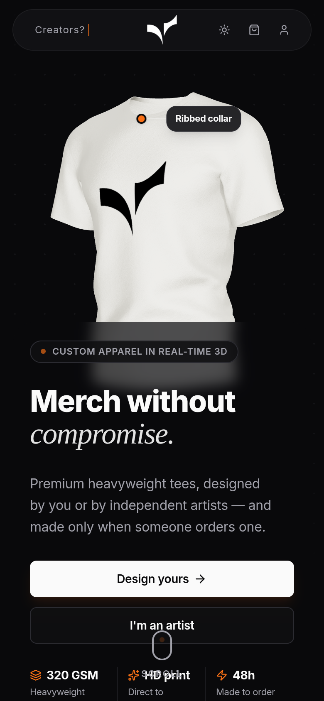

<div align="center">


# chth.shop

**Design merch in 3D, sell it from your own storefront.**

A full-stack platform for artists: a real-time 3D garment designer, per-artist storefronts,
cart and orders, OAuth sign-in, and a Telegram bot for managing stock and sales.

[](https://github.com/chethober/chth.shop/actions/workflows/ci.yml)
[](https://github.com/chethober/chth.shop/actions/workflows/release.yml)
[](LICENSE)


</div>



## Features

- **3D design studio**: pick a garment (tee, hoodie, pants), colourway and artwork, and preview it
  live in a React Three Fiber scene.
- **Artist storefronts**: every artist gets a page at `/<username>` with their bio, social links
  and products (filter by type, sort), editable from the account dashboard.
- **Shop flow**: cart, checkout and order history with cancellation, backed by a products API
  with type, artist and search filters.
- **OAuth-only sign-in**: Google, X (OAuth 2.0 + PKCE) and Telegram Login. The API issues JWTs.
- **Artist program**: users accept the collab terms and open a store; artists earn royalties
  per sale.
- **Telegram bot**: artists manage items, prices and stock from Telegram and get sale and
  low-stock alerts. It runs on Telegram Serverless; see [`telegram-bot/`](telegram-bot/).
- **One-command deploy**: Docker Compose runs PostgreSQL, the API and Next.js, and CI publishes
  images to GHCR.

### Marketplace

Monorepo for CHTH: a centralized print-on-demand marketplace where artists and merchants sell merch
(tees, hoodies, pants, mugs, caps, totes) that buyers can personalize in a 3D studio and pay for in crypto.
Sign-in is Google, X or Telegram.

- `/shop`: every listing from every store: All, Drops & limited, and Following feeds, filters by product
  type and seller kind, sort by top rated. `/p/<id>`: product page with options, reviews and wishlist.
- 12 products: tee, hoodie, joggers, cap, beanie, mug, takeaway cup, water bottle, tote, phone case, poster,
  sticker. Models and their licenses: [frontend/public/models/LICENSES.md](frontend/public/models/LICENSES.md).
- Payments: TON or USDT on TON from the buyer's wallet (TON Connect), or any coin through NOWPayments.
- Seller payouts: sales earnings (and referral credit) become payable after shipping + a hold period and are
  paid monthly in USDT, automatically to TON addresses (`npm run payouts`, or Admin → Payouts).
- Telegram Mini App: the shop runs inside Telegram with automatic sign-in, Telegram's theme and back button,
  and `t.me/<bot>/<app>?startapp=…` deep links; the bot answers `/start`, `/shop`, `/orders`… (setup below).
- NFT-backed merch: sellers mark listings as NFT-backed and/or limited editions with timed drops. Each unit sold
  gets a numbered collectible the buyer claims to their TON wallet; `/verify/<serial>` checks authenticity.
- Growth: verified-buyer reviews, wishlist, follow stores, referral links (`?ref=CODE`: 10% off the first
  order, 5% credit to the referrer), Telegram bot notifications for buyers and sellers.
- `/design`: 3D studio. Buyers order their own designs; sellers publish them to their store; `?product=<id>`
  personalizes a listing the seller marked customizable.
- `/collab`: open a store as an artist or merchant. `/account`: products, sales, payout address, orders.
- `/admin`: fulfillment queue for admins (`npm run make-admin -- <username>` in the backend).

## Screenshots

| Design studio | Artist storefront |
| :---: | :---: |
|  |  |
| **Artist program** | **Sign in** |
|  |  |
| **API reference** (`/api-docs`) | **Mobile** |
|  |  |

## Tech stack

| Layer | Tools |
| --- | --- |
| Frontend | Next.js 16 (App Router), React 19, TypeScript, Tailwind CSS v4, Three.js / React Three Fiber / drei, Framer Motion, GSAP, Zustand, HeroUI |
| Backend | Node.js 22, Express 4, Prisma 6, PostgreSQL, Passport, JWT, Helmet, rate limiting |
| Bot | Telegram Serverless (`tgcloud`), SQLite |
| Ops | Docker, Docker Compose, GitHub Actions, GHCR, Dependabot |

## Repository layout

| Path            | What it is                                                              |
| --------------- | ----------------------------------------------------------------------- |
| `frontend/`     | Next.js app (UI). See [frontend/README.md](frontend/README.md).         |
| `backend/`      | Express + Prisma REST API. See [backend/README.md](backend/README.md).  |
| `telegram-bot/` | Artist bot on Telegram Serverless. See its README.                      |
| `docs/API.md`   | REST API reference (also served on the site at `/api-docs`).            |
| `assets/brand/` | Master logo files (the web-ready copies live in `frontend/public`).     |
| `hezar/`        | Separate Python utility app, not used by the shop.                      |
| `specs/`        | Feature specs.                                                          |

## Quick start (Docker)

The whole stack (PostgreSQL, API, Next.js) runs with Docker Compose:

```bash
git clone https://github.com/chethober/chth.shop.git && cd chth.shop
cp .env.example .env    # set JWT_SECRET and SESSION_SECRET (e.g. `openssl rand -hex 32`)
docker compose up -d --build
```

The site is served at http://localhost:3000 (change with `FRONTEND_PORT`). The browser
only talks to Next.js, which proxies `/api` and `/uploads` to the backend container. On start
the backend upgrades older data (`prisma/upgrade.sql`) and syncs the schema with `prisma db push`.
Set `NOWPAYMENTS_API_KEY` / `NOWPAYMENTS_IPN_SECRET` in `.env` for crypto checkout (see
[backend/README.md](backend/README.md#crypto-payments)). Without them, checkout reports that payments aren't
configured; to try the full flow, run locally (below), where a mock payment page is the default. Data and uploaded images live
in the `pgdata` and `uploads` volumes.

```bash
docker compose exec backend npm run db:seed   # load demo artists, merchants and products (resets data)
docker compose exec backend npm run make-admin -- <username>
docker compose logs -f backend                # follow API logs
docker compose down                           # stop (add -v to also delete the data)
```

`BACKEND_URL` and `NEXT_PUBLIC_API_URL` are baked into the frontend image at build time,
so rebuild it (`docker compose build frontend`) after changing them.

### Prebuilt images

Every push to `main` and every `v*` tag publishes multi-arch images:

```
ghcr.io/chethober/chth-backend:<edge|latest|x.y.z>
ghcr.io/chethober/chth-frontend:<edge|latest|x.y.z>
```

The frontend image expects the API at `http://backend:5000`, the service name used in
`docker-compose.yml`. To run from the images instead of building, replace each `build:` block
in the compose file with the matching `image:`.

## Local development

You need Node.js 22, Yarn 1 (`corepack enable`), and PostgreSQL.

```bash
yarn install                           # installs both workspaces
cp backend/.env.example backend/.env   # then fill in DATABASE_URL and secrets
yarn workspace chth-backend prisma db push
yarn workspace chth-backend dev        # http://localhost:5000/api
yarn workspace chth-frontend dev       # http://localhost:3000
```

### Configuration

All settings come from environment variables. The annotated templates are
[`.env.example`](.env.example) (Docker) and [`backend/.env.example`](backend/.env.example) (local).

| Variable | Required | Purpose |
| --- | --- | --- |
| `JWT_SECRET`, `SESSION_SECRET` | yes | Signing secrets: long random strings |
| `FRONTEND_URL` | | Public URL(s) of the site, comma-separated |
| `GOOGLE_CLIENT_ID` / `_SECRET` | | Google sign-in |
| `TWITTER_CLIENT_ID` / `_SECRET` | | X sign-in |
| `TELEGRAM_CLIENT_ID` / `_SECRET` | | Telegram sign-in (OpenID Connect) |
| `TELEGRAM_BOT_TOKEN`, `TELEGRAM_ADMIN_IDS` | | Bot sign-in and order alerts |
| `OUTBOUND_PROXY` | | HTTP proxy for reaching X/Telegram |
| `HUB_URL`, `HUB_SECRET`, `SHOP_CURRENCY` | | CHTH hub reporting |

Every sign-in provider is optional; providers without keys are simply unavailable. OAuth
callback setup is described in [backend/README.md](backend/README.md#oauth-and-other-devices).

## Languages

The storefront (home page, artist stores, cart and checkout, sign-in and the design studio)
comes in English, Persian, Arabic, Russian and Spanish, with right-to-left layout for Persian and
Arabic. Strings live in `frontend/lib/i18n/strings.ts`, keyed by their English text, so a missing
translation shows English; components use `useT()` from `frontend/lib/i18n`. The language comes
from `?lang=`, the `chth_lang` cookie shared by every CHTH site, or the browser, and visitors
switch it in the footer. Product and artist names are shown as written. The account pages are
English for now.

## CHTH kit and hub

`frontend/chth-kit/` and `backend/src/chth-kit/` are generated from the shared CHTH kit (brand
tokens, logo, languages, product links, the "Part of CHTH" footer, signed hub client): don't edit
them here. With `HUB_URL` and `HUB_SECRET` set, the backend reports new orders, sign-ups and
server errors to the CHTH hub, and answers the hub's signed calls at `GET /api/internal/stats`
and `POST /api/internal/orders/status` (the admin bot's order buttons). Without them nothing is
sent and `/api/internal` refuses every call. `cd backend && npm test` checks the signing.

## Telegram Mini App

1. In @BotFather: `/newapp` pointing at `https://<your-domain>/shop`; note the
   app short name.
2. Set `TELEGRAM_BOT_TOKEN`, `TELEGRAM_WEBHOOK_SECRET` (any random string),
   `TELEGRAM_MINI_APP_NAME`, and `TELEGRAM_MINI_APP_LINK=https://t.me/<bot>/<app name>` (frontend build arg).
3. Run `docker compose exec backend npm run telegram:setup` once: it registers the webhook
   (`/api/telegram/webhook`), the chat menu button that opens the shop, and the command list.

Inside Telegram the site signs users in from the Mini App's `initData` (verified with the bot token), so there's
no login screen. Share links use `startapp=ref_<CODE>` (referral) and `startapp=p_<product id>`.

## Payouts

`npm run payouts -- --dry-run` lists balances; `npm run payouts` (cron, e.g. monthly) creates payouts and sends
the USDT-on-TON ones from the platform wallet (`TON_WALLET_MNEMONIC`, funded with USDT plus ~0.05 TON per
payout for fees). Payouts to other networks stay *Scheduled* until an admin sends them and records the
transaction under Admin → Payouts.

## CI/CD

| Workflow | Trigger | What it does |
| --- | --- | --- |
| [`ci.yml`](.github/workflows/ci.yml) | PRs, pushes to `main` | Frontend typecheck + production build, ESLint (non-blocking for now), Prisma schema validation + backend syntax check, Docker image builds, compose validation |
| [`release.yml`](.github/workflows/release.yml) | pushes to `main`, `v*.*.*` tags | Builds `linux/amd64` + `linux/arm64` images and pushes them to GHCR; tags also create a GitHub release with generated notes |
| [`issues.yml`](.github/workflows/issues.yml) | new issues | Auto-labels and acknowledges issues |
| [Dependabot](.github/dependabot.yml) | weekly | npm, GitHub Actions and Docker base-image updates |

To cut a release:

```bash
git tag v1.0.0 && git push origin v1.0.0
```

## Contributing

Contributions are welcome! Read [CONTRIBUTING.md](CONTRIBUTING.md) to get started. Please
follow the [Code of Conduct](CODE_OF_CONDUCT.md), and report security issues privately as
described in [SECURITY.md](SECURITY.md).

## License

The code is released under the [MIT License](LICENSE) © Cheth.

The CHTH name and logo (`assets/brand/`, `frontend/public/logo-*.png`) identify this project
and are not covered by the code license. Please don't use them to brand a fork.
