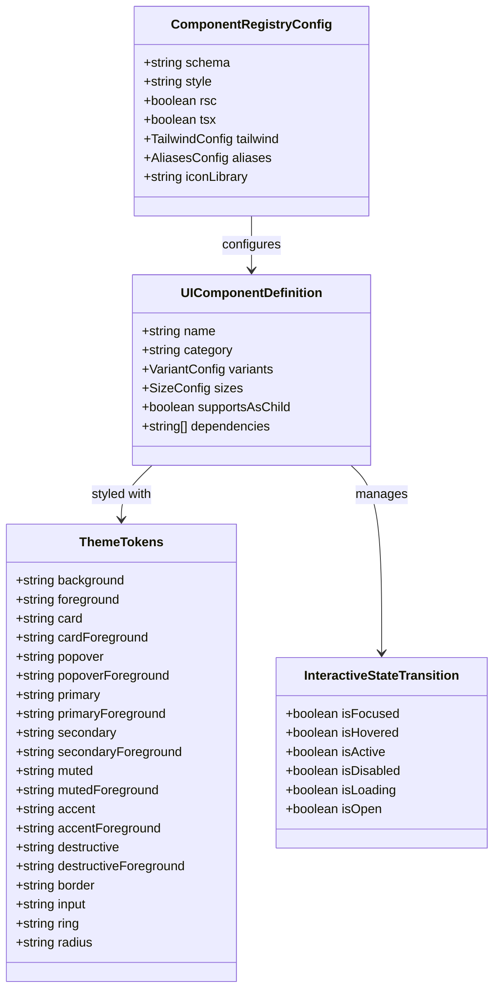

# Data Model: UI Component System & Tokens

**Feature**: Rewrite UI Components with shadcn/ui
**Status**: Ready

---

## 1. Core Entities



---

## 2. Entity Descriptions

### 2.1 ComponentRegistryConfig (`components.json`)
The central metadata contract specifying project layout, styling system, and path aliases for the component ecosystem.

| Field | Type | Description |
|-------|------|-------------|
| `$schema` | `string` | URL to JSON Schema (`https://ui.shadcn.com/schema.json`) |
| `style` | `"default" \| "new-york"` | Visual style design (`"default"`) |
| `rsc` | `boolean` | React Server Components support (`true`) |
| `tsx` | `boolean` | TypeScript usage (`true`) |
| `tailwind.config` | `string` | Relative path to Tailwind configuration (`"tailwind.config.js"`) |
| `tailwind.css` | `string` | Relative path to global CSS file (`"app/globals.css"`) |
| `tailwind.baseColor` | `string` | Base palette palette (`"neutral"`) |
| `tailwind.cssVariables` | `boolean` | CSS variable token usage (`true`) |
| `aliases.components` | `string` | Import alias for components (`"@/components"`) |
| `aliases.utils` | `string` | Import alias for utility functions (`"@/lib/utils"`) |
| `aliases.ui` | `string` | Import alias for UI primitives (`"@/components/ui"`) |
| `iconLibrary` | `string` | Icon library identifier (`"lucide"`) |

---

### 2.2 ThemeTokens
The HSL semantic color tokens exposed via CSS variables in `frontend/app/globals.css`.

| Token Name | Light Value (Typical) | Dark Value (Typical) | Purpose |
|------------|-----------------------|----------------------|---------|
| `--background` | `40 20% 98%` | `240 10% 3.9%` | Default canvas/page background |
| `--foreground` | `240 10% 5%` | `0 0% 98%` | Default typography & icon color |
| `--card` | `0 0% 100%` | `240 8% 7.5%` | Card container background |
| `--primary` | `240 10% 5%` | `0 0% 98%` | Primary action button/indicator background |
| `--secondary` | `40 15% 93%` | `240 6% 14%` | Secondary button/pill background |
| `--muted` | `40 12% 92%` | `240 6% 12%` | Inactive tab, disabled state background |
| `--accent` | `40 15% 90%` | `240 6% 16%` | Hovered item, selection highlight |
| `--destructive` | `0 84% 45%` | `0 72% 51%` | Destructive action / error callout |
| `--border` | `40 10% 85%` | `240 6% 18%` | Element outline, separator lines |
| `--ring` | `240 10% 5%` | `0 0% 98%` | Focus ring outline color |

---

### 2.3 UIComponentDefinition & Variants
Every component provides a CVA definition standardizing its variant and size dimensions:

```typescript
// Conceptual schema for CVA configuration
interface ComponentVariantModel<TVariants extends string, TSizes extends string> {
  base: string; // Tailwind classes shared across all states
  variants: {
    variant: Record<TVariants, string>;
    size?: Record<TSizes, string>;
  };
  defaultVariants: {
    variant: TVariants;
    size?: TSizes;
  };
}
```

---

## 3. State Transitions

### Interactive Controls (Button, Input, Switch, Slider)
- **Idle**: Standard token colors (`bg-primary`, `border-input`).
- **Hover**: Subtle brightness / opacity shift (`hover:bg-primary/90`, `hover:border-accent`).
- **Focus-Visible**: Focus ring with 2px offset (`focus-visible:ring-2 focus-visible:ring-ring focus-visible:ring-offset-2`).
- **Active / Pressed**: Micro-compression (`active:scale-[0.98]`).
- **Disabled**: Dimmed opacity (`disabled:pointer-events-none disabled:opacity-50`).

### Overlay Transitions (Dialog, Sheet, DropdownMenu)
- **Closed**: `data-[state=closed]:animate-out data-[state=closed]:fade-out-0 data-[state=closed]:zoom-out-95`.
- **Open**: `data-[state=open]:animate-in data-[state=open]:fade-in-0 data-[state=open]:zoom-in-95`.
- **Focus Management**: Focus trapped inside dialog on mount; focus restored to trigger on unmount.
